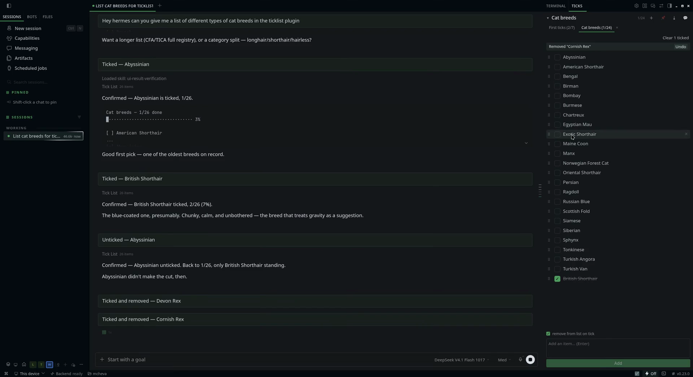

# TickList

A checklist for Hermes where the direction of travel is unusual: **you tick, the agent is told.**

Hermes' built-in `todo_list` is agent-authored and user-read. TickList is the inverse —
checkboxes in a desktop pane, and every tick is posted into the conversation as it happens,
so the model knows something is finished without you saying it.



**Demo:** [`demo/ticklist-demo.mp4`](demo/ticklist-demo.mp4) — 70 seconds, silent, recorded in
the Desktop app: a list is requested, ticks land in the chat as they happen, then tabs, pin,
export, drag-reorder and the announce toggle in one pass. The screenshot above is a frame from it.

- Source: https://github.com/mchevatheachiever/hermes-ticklist
- License: MIT

## Requirements

| | |
|---|---|
| Hermes | `>=0.21.5` |
| Python | 3.10+ — stdlib only, no dependencies |
| Desktop app | any. The docked-pane behaviour is feature-detected; older desktops fall back to a right-docked pane |

## Install

```bash
hermes plugins install mchevatheachiever/hermes-ticklist
```

Enable it in **Settings ▸ Plugins**, then **restart the desktop app**. Enabling publishes
the agent half immediately, but the pane's `plugin.js` is copied into
`<hermes home>/desktop-plugins/ticklist/` by the app at startup — with the app already
running there is nothing to show until then.

If you are **updating** an existing install, restart the Hermes process serving your
dashboard — that is what serves `/api/plugins/ticklist/`, and it is rarely the messaging
gateway. On a systemd install `systemctl --user list-units 'hermes*'` names them; the
desktop one is usually `hermes-serve-<profile>.service`. Restarting only the desktop app
is not enough: routes and tool schemas come from that process, so the pane keeps calling
endpoints it cannot reach and shows a 404.

The pane opens beside the terminal pane as a sibling tab. If you close it, open the command
palette (**Ctrl+K**, or **⌘K** on macOS) and run **TickList: show checklist**.

On first run you get one example list, **First ticks** — seven rows that each demonstrate
something. It is seeded once, so deleting it is final.

## Use

Ask Hermes:

> make me a shopping list: milk, bread, coffee, dish soap

> tick off the coffee

> what's still on my list?

Or type straight into the pane. Ticking posts `Ticked — <item>` into the chat, which is what
makes the agent see it.

## The pane

| Control | What it does |
|---|---|
| **Tabs** | one per list, showing `done/total`; they wrap, and scroll past five rows. The tab you were last on is remembered |
| **＋** | create a new list — type a name, Enter. It opens empty and becomes active; if the name already exists it switches to that list instead |
| **📌 header button** | pins the list you're on. Pinned lists sort to the front of the strip and show a 📌 on their tab; pinned tabs reorder among themselves |
| **× on the tab** | deletes that list. Asks first, then offers undo for 12 seconds |
| **Drag a tab** | reorders the strip — drop on the left or right half of a tab to land before or after it |
| **Checkbox** | ticks or unticks the row and announces it in the chat |
| **⠿ grip** | drag to reorder a row |
| **✕ on a row** | removes that one item, announced as `Removed — <item>`, with undo |
| **Add bar** | type and press Enter. Multi-line paste adds one item per line, in one request |
| **Clear N ticked** | appears once something is ticked; removes the finished rows, with undo |
| **⤓** | export: text, Markdown, CSV, JSON, or copy to the clipboard |
| **Undo** | a 12-second bar after deleting a list, clearing ticked rows, removing a row, or a tick that removes its own row |
| **▾** | collapses the pane to its header |
| **💬 / 🔇** | whether ticks are posted to the chat. On by default, per pane session |
| **☐ remove from list on tick** | off by default; with it on, a tick deletes the row instead of striking it through. The choice is remembered |
| **☑ status bar** | opens or closes this pane's tab; dimmed when closed. The whole side panel is collapsed by the terminal pill, which takes this pane with it |

Rows sit unticked-first, with ticked ones collected at the bottom and your own order
preserved inside each group.

### Keyboard

| Where | Keys | What it does |
|---|---|---|
| Add bar | **Enter** | add what you typed |
| Add bar | **Shift+Enter** | new line, so one entry can hold several items |
| New-list row | **Enter** / **Esc** | create / cancel |
| ⠿ grip, focused | **↑** / **↓** | move the row up or down |
| Tab, focused | **←** / **→** | move the tab left or right |
| Tab, focused | **Enter** / **Space** | switch to that list |
| Export menu | **Esc** | close it |

## What the agent sees

Announcing is on by default. Each of these is posted as a user turn, so the model reads it
like anything else you type:

| You did | Chat gets |
|---|---|
| ticked a row | `Ticked — <item>` |
| unticked a row | `Unticked — <item>` |
| added from the bar | `Added — <item>`, or `Added N items` for a multi-line paste |
| removed a row | `Removed — <item>` |
| ticked with remove-on-tick on | `Ticked and removed — <item>` |
| cleared the finished rows | `Cleared N ticked from <list>` |
| deleted a list | `Deleted list — <name> (N items)` |
| hit undo | `Restored — <name>` |

Toggle **🔇** when you want to tick things quietly — the list still changes, the agent just
isn't told.

## Export

`⤓` in the header offers four files and a clipboard copy:

| Format | Good for |
|---|---|
| Text | pasting into a message or a terminal |
| Markdown | `- [ ]` task list — Obsidian, GitHub, Notion |
| CSV | spreadsheets, spreadsheet-style imports |
| JSON | the stored list verbatim, including ids and timestamps |

CSV cells that a spreadsheet would otherwise evaluate (`=`, `+`, `-`, `@`) are prefixed with
an apostrophe so they stay text.

## Tools

| Tool | Purpose |
|---|---|
| `tick_add` | Add items; keeps existing, skips duplicates |
| `tick_set` | Tick or untick by id or text |
| `tick_list` | Read a list, plus every list's name, pinned state and `done/total` |
| `tick_remove` | Delete one item |
| `tick_clear` | Empty a list, or `done_only: true` |
| `tick_delete_list` | Delete a whole list |

A bundled skill (`ticklist:ticklist`) and `/tick [list]` print the list without spending a
model turn.

## Privacy and access

- **No network calls.** Nothing leaves the machine except the tick notices in the chat.
- **Local state only**: `<hermes home>/plugin-data/ticklist/lists.json`, written atomically
  under a lock so the pane and the agent can't clobber each other.
- **Limits**: 240 characters per item, 200 per list name, 2,000 items per list, 50 lists.
  Every row is drawn, so a list of a couple of thousand will feel heavy — fine in the
  hundreds.
- **Ticked text goes to your model provider** when announcing is on — that post is a real
  user turn and lands in the session transcript.
- **No credentials, no environment variables, no telemetry.**
- **API access is the dashboard's**, not the plugin's: routes are mounted at
  `/api/plugins/ticklist/` behind Hermes' own auth.

## API

| Route | Purpose |
|---|---|
| `GET /lists` | every list with counts, plus the active list's rows |
| `GET /lists/{name}` | one list with its rows |
| `GET /lists/{name}/export?fmt=` | `txt`, `md`, `csv` or `json` → `{filename, mime, content}` |
| `POST /lists` | add items, or create an empty list with `create_empty` |
| `PATCH /lists/{name}` | pin or unpin |
| `PATCH /order` | reorder the tab strip |
| `PATCH /lists/{name}/order` | reorder items within a list |
| `PATCH /lists/{name}/items` | write a list's rows verbatim (undo) |
| `PATCH /items/{id}?list=` | tick or untick |
| `DELETE /items/{id}?list=` | remove one row |
| `DELETE /lists/{name}` | remove a list |
| `POST /clear?list=` | empty a list, or only its ticked rows |
| `GET /health` | `{ok, lists}` |

## License

MIT — see [LICENSE](LICENSE).
